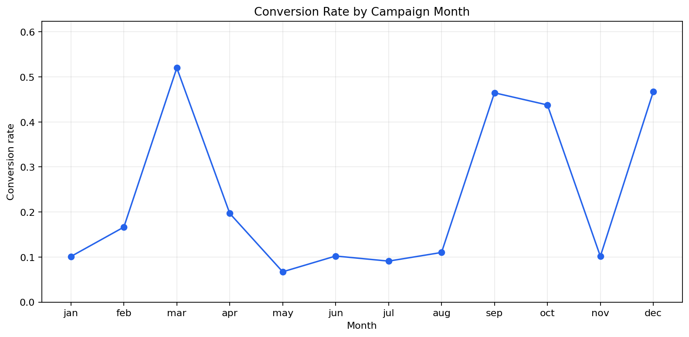
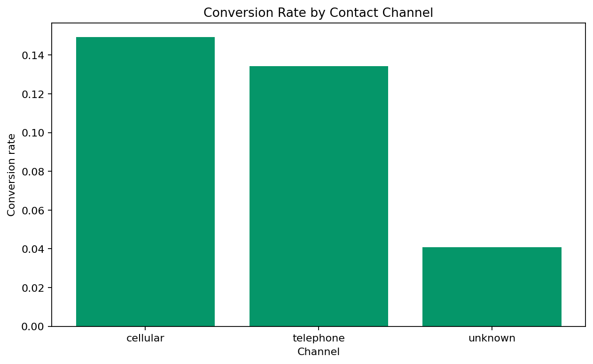
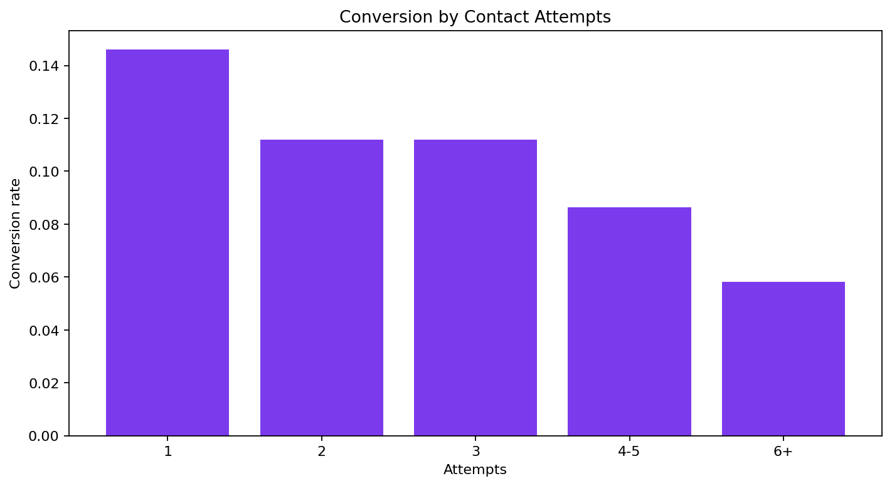

# Bank Marketing Campaign Outcomes

**Author:** Mohammed Adeen Shaik  
**Review date:** 11 October 2026

## Research question

Which contact channels and contact-frequency groups have different observed subscription rates?

## Data and provenance

UCI Bank Marketing bank-full.csv, a historical Portuguese bank campaign sample.

Source materials are linked from the repository README. Input fingerprints are recorded in [the evidence manifest](evidence.json) so a reader can identify the exact committed artifacts used in this review.

## Method and analytical rationale

The subscription label becomes a binary indicator. Grouped counts give conversion numerators and denominators. Calendar month labels combine observations across years and are not a continuous time series.

## Findings and interpretation

Fresh execution on 11 October 2026. The **45,211 contact records** contain **5,289 subscriptions**, an observed conversion rate of **11.70%**. Channel rates vary, but selection differences prevent a causal claim that one channel improves conversion. Month categories pool years; the chart is a calendar-month comparison, not a time trend.

| contact | contacts | conversions | conversion_rate |
|---|---|---|---|
| cellular | 29285 | 4369 | 0.1491890046098685 |
| telephone | 2906 | 390 | 0.1342050929112181 |
| unknown | 13020 | 530 | 0.0407066052227342 |

## Limitations

Call duration is known after the call and must not enter pre-contact targeting. Channel and contact-count differences are observational; they do not measure causal campaign lift.

## Reproduction

Use the setup commands and input contract in the [repository README](https://github.com/Adeen1607/marketing-campaign-performance#readme). Open the [notebook catalogue](notebooks.html) for annotated code and saved outputs. Keep raw records and model binaries local; public reports contain aggregate results or source-embedded figures.

## Final visual results

*Figure from key_visuals.ipynb, original code cell 3.*

*Figure from key_visuals.ipynb, original code cell 4.*

*Figure from key_visuals.ipynb, original code cell 5.*

